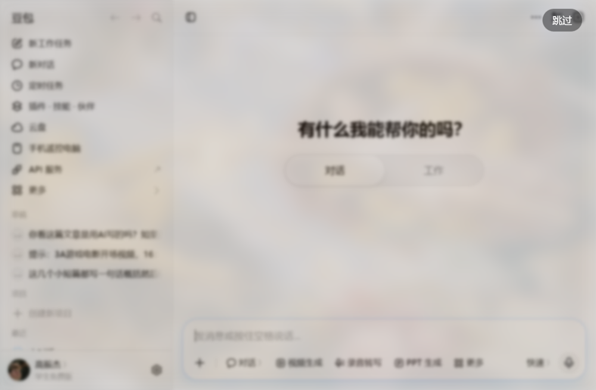

# 豆包开机动画 · doubao-boot-animation

打开豆包桌面端时，先在你的窗口里**满屏播放一段带声音的片头**；播完不是硬切，而是**虚化淡出**——
豆包从模糊里浮出来，就像它本来就该这样出现。


播完的那一瞬间（应用正在「从糊到清」）：



---

## 先说清楚它是什么

**豆包桌面端没有插件系统。** 它不是 Electron（没有 `app.asar` 可以改），也没有任何官方
扩展点：它是自绘的 Chromium 壳（`Doubao.exe` + `Doubao.dll`，Chromium 147），界面本身是
`chrome://doubao-chat/chat` 这个特权页里的 React 应用。

所以这个项目走的是**不装进豆包、也不改豆包**的路：

```
launch.vbs ──▶ 以 --remote-debugging-port 正常启动豆包（只监听 127.0.0.1）
            ──▶ 连上 DevTools 协议，拿到主窗口的页面目标
            ──▶ 在页面里挂一个全窗口浮层，播放 assets/boot.mp4（内联成 blob，不走网络）
            ──▶ 播完：虚化淡出 → 拆掉浮层 → 自己退出
```

它更像一个**带片头的豆包启动器**，而不是一个"装进豆包里的插件"。这是这个客户端形态下
唯一不碰安装文件、不碰签名的做法。

## 安装

1. 装 [Node.js 22+](https://nodejs.org/)（只需一次；`launch.vbs` 会检查）。
2. 把整个文件夹解压到任意位置（推荐 `%LOCALAPPDATA%\Programs\doubao-boot-animation`）。
3. 双击 **`launch.vbs`**（静默）或 **`launch.cmd`**（能看到日志）。

想让它变成"日常打开豆包的方式"：右键 `launch.vbs` → 发送到 → 桌面快捷方式，
把名字改成「豆包」，用它替换原来的豆包图标即可。

## 换你自己的片头

把你自己的 mp4 放到 `assets/boot.mp4`（覆盖原文件），或者在 `config.json` 里写别的路径：

```json
{ "video": "D:\\videos\\my-intro.mp4" }
```

建议：**H.264 + AAC + `+faststart`（moov 前置）**。索引表在末尾的 mp4 要先整段下载才出画面，
开机动画这种场景会明显看到黑屏。仓库里的 `assets/boot.mp4` 是 720p60 / 2.9MB / faststart /
响度标准化过（-16.3 LUFS）的版本。

如果换视频后觉得"声音太小"，多半不是播放问题而是源片本身太轻（这批 AI 生成视频常见 -35 LUFS 上下）。
一行命令拉齐响度：

```bash
ffmpeg -i in.mp4 -c:v copy -af "loudnorm=I=-16:TP=-1.5:LRA=11" -c:a aac -b:a 160k -ar 48000 -movflags +faststart out.mp4
```

## 配置（`config.json`）

| 字段 | 默认 | 说明 |
|---|---|---|
| `video` | `assets/boot.mp4` | 片头视频，相对项目根目录或绝对路径 |
| `fit` | `cover` | `cover` 铺满裁切；`contain` 完整显示、留黑边 |
| `muted` | `false` | **默认带声音**；改成 `true` 就静音 |
| `volume` | `1` | 音量 0~1 |
| `autoplayWithSound` | `true` | 允许"没有用户手势也能出声"地启动豆包（见下） |
| `skipButton` | `true` | 右下角「跳过」按钮 |
| `skipOnClick` | `true` | 点击画面任意处跳过 |
| `skipOnEscape` | `true` | Esc 跳过 |
| `handoffMs` | `520` | 退场过渡时长，**要比 CSS 的 460ms 略长** |
| `waitForWindowMs` | `15000` | 等窗口可见的上限；超时就不播（不空放） |
| `firstFrameMs` | `8000` | 等首帧的上限；超时就交接，不把界面扣住 |
| `maxVideoMB` | `30` | 内联视频的体积上限（视频是直接进内存的） |
| `doubaoPath` | `""` | 豆包主程序；留空自动找 |

## 声音（0.2.0 起默认开）

开机动画当然该有声音，但"刚启动、用户什么都没点"正是 Chromium **自动播放策略**要拦的场景：
带声音的 `play()` 会被拒绝。这里有三层处理：

1. **启动参数**：给豆包加 `--autoplay-policy=no-user-gesture-required`（`autoplayWithSound: true`），
   正常情况直接出声。这是本项目能"带声音"的根本原因——启动命令在我们手里。
2. **兜底**：万一仍被拦（企业策略、标志失效），**退回静音播放**而不是放弃整个片头，
   并在画面上提示「点击开启声音 · 再点任意处跳过」：第一次点击开声音，再点才跳过。
3. **收尾**：退场时音量在 `handoffMs` 内线性收到 0，声音不会在切画面的瞬间被掐断。

音量与静音：`volume`（0~1）、`muted`。想安静启动就把 `muted` 改成 `true`。

> 仓库里的 `assets/boot.mp4` 做过**响度标准化**：源片整体只有 **-36 LUFS**（峰值 -15.3 dBTP），
> 直接播在笔记本上几乎听不见；已拉到 **-16.3 LUFS / -1.4 dBTP**（`loudnorm`）。
> 换自己的视频时如果也觉得"声音太小"，用同样的参数过一遍即可。

## 为什么「跳过」在右下角

豆包把**窗口按钮（最小化 / 最大化 / 关闭）画在页面右上角**，不是系统绘制的。
有些桌面端会把「跳过」放在右上角，因为系统标题栏会吃掉点击；豆包正好相反——
浮层覆盖整个页面，放右上会**压住关闭键**：想关窗口的人会先点到「跳过」。
所以这里把跳过放右下角，Esc 也留着。

## 安全与隐私

- **调试端口只监听 `127.0.0.1`**，端口号每次随机；注入器退出后进程结束。
- **不建任何本地服务**：视频以 base64 内联进页面再转成 `blob:`，既不发网络请求，也不开监听端口。
- **不联网、不上传**；视频不离开本机。
- **不改豆包任何文件**：不碰安装目录、不写注册表、不装扩展。
- ⚠️ 需要如实说明的一点：**在豆包运行的这段时间里，本机上的其它程序理论上可以连上
  那个调试端口并操控豆包界面**。这是 Chromium 调试端口的固有性质，任何走这条路的
  工具都一样。规避方式：用普通豆包快捷方式启动（不带端口）就没有这个面；本工具也把
  动画结束后的端口"用不上"这件事写在了架构文档里——它没法在进程存活时关掉。
- 不信？`bin/inject.mjs` 一共五百来行，全是可读的 Node 代码，没有任何打包/混淆。

## 已知限制

- **单实例**：豆包已经在运行时，再带端口启动不会生效（会被转交给已有进程）。
  这时启动器会明确提示"先退出豆包"，而不是假装启动了。
- **必须从本启动器进入**：你点原来的豆包图标，就没有片头。
- **Windows**：目前只做了 Windows。豆包有 macOS 版，路径与进程检测需要另写。
- **最小化启动**：如果豆包启动时是收在托盘/最小化的，片头不会空放（会等窗口可见，超时就不播）。
- **声音依赖启动参数**：`autoplayWithSound: false`（或企业策略禁止）时，片头会退回静音并把
  「点击开启声音」交给用户；这一点在日志里记作 `soundBlocked`。
- **豆包更新后可能失效**：页面地址（`chrome://doubao-chat/chat`）或窗口按钮布局变化，
  需要跟着调。`bin/inject.mjs` 里选页面目标的逻辑已经做了容错（按 URL / 标题两路匹配）。

## 排错

| 现象 | 原因 / 处理 |
|---|---|
| 双击没反应 | 没装 Node 22+（静默版会转到 `launch.cmd` 显示原因） |
| 豆包开了，但没片头 | 看 `%LOCALAPPDATA%\DoubaoBootAnimation\logs\latest.log`；最常见是"豆包已在运行" |
| 片头是黑的 | 视频没有 faststart，或编码浏览器不支持（用 H.264 + AAC） |
| 片头结束后界面卡住 | 不该发生：首帧/播放看门狗会强制交接；有日志请提 issue |
| 换视频没生效 | 确认改的是 `config.json` 指向的那个文件，且没被豆包占用 |

日志永远在：`%LOCALAPPDATA%\DoubaoBootAnimation\logs\latest.log`

## 卸载

删掉整个文件夹即可。它没有安装程序、没有服务、没有注册表项、没有开机自启
（要自启请自己把快捷方式放进启动目录）。

## 目录结构

```
launch.vbs / launch.cmd    入口（静默 / 带日志）
config.json                片头与行为配置
bin/inject.mjs             注入器：启动豆包 → CDP 连接 → 注入浮层 → 交接 → 清理
assets/boot.mp4            片头视频（可替换）
scripts/smoke.mjs          端到端自检（会启动并关闭一次豆包）
docs/ARCHITECTURE.md       为什么这么做、怎么验证的
docs/media/                README 用的截图
```

## 它是怎么验证的

不是"看起来能跑"，而是每一步都量过：

| 验证项 | 结果 |
|---|---|
| 豆包是否认调试端口 | `/json/version` 返回 `Chrome/147.0.7727.149`，1.4 秒就绪 |
| 主窗口目标 | `doubao://doubao-chat/chat` → 实际文档 `chrome://doubao-chat/chat`，无 CSP |
| 视频怎么送进去 | **不走网络**：内联 blob 后 `loadedmetadata` **68ms**、`playing` **261ms**（走本机 HTTP 时请求会被应用启动挤到 3.2 秒后才发出） |
| 是否有声音 | `muted:false / volume:1 / soundBlocked:false`，`--autoplay-policy=no-user-gesture-required` 下直接出声 |
| 浮层是否真的铺满窗口 | 注入后截图：整窗覆盖（含豆包自绘标题栏），见上面的图 |
| 交接是否生效 | 退场 230ms 时截图：视频已淡出、应用呈强模糊，随后转清 |
| 退场清理 | 注入器 exit 0，`#dba-root` 与样式表都已移除 |

`npm run smoke` 会把上面这条链路自动跑一遍（需要豆包没在运行，测试结束会关掉它自己启动的实例）。
它同时是"有声音"的验收：断言首帧时 `muted === false` 且音量 > 0。

## 许可

BSD-3-Clause，见 [LICENSE](LICENSE)。`assets/boot.mp4` 由项目作者提供，随仓库以相同条款分发。
